# Authentik-test — documentatie

## 1. Doel

We hebben lokaal op een Windows-laptop getest hoe je een eenvoudige HTML-website met Docker aanbiedt en met **authentik** beveiligt. Daarna hebben we onderzocht hoe je toegang kunt beperken tot een groep administrators.

**Huidige stand:** de test met een gewone website en een aparte adminwebsite is uitgevoerd. Het plan om beide samen te voegen tot **één website met verschillende functies per rol** is nog **niet uitgevoerd**.

> Deze documentatie is gebaseerd op onze stappen en het oorspronkelijke Word-document. Sommige tussentijdse configuraties zijn later aangepast. Controleer de actuele bestanden voordat je de omgeving opnieuw opbouwt.

## 2. Wat hebben we gebruikt?

| Onderdeel | Functie |
|---|---|
| Windows + VS Code | Bestanden schrijven en commando's uitvoeren |
| Docker Desktop | Containers lokaal draaien |
| Docker Compose | Meerdere containers configureren en starten |
| Nginx (`nginx:alpine`) | Statische HTML-pagina's aanbieden |
| authentik | Aanmelden en toegangsbeleid beheren |
| PostgreSQL | Database van authentik |
| Proxy Provider | Webverzoeken via authentik beveiligen |
| Embedded Outpost | Voert de proxybeveiliging van authentik uit |

Een VM was voor deze lokale test niet nodig.

## 3. Eerste HTML-website

We maakten de map `authentik-test` met een `index.html`:

```html
<!DOCTYPE html>
<html lang="nl">
<head>
    <meta charset="UTF-8">
    <meta name="viewport" content="width=device-width, initial-scale=1.0">
    <title>Authentik Test</title>
</head>
<body>
    <h1>Welkom!</h1>
    <p>Deze website wordt later beveiligd met authentik.</p>
</body>
</html>
```

Eerst testten we de pagina rechtstreeks in de browser (eventueel met Live Server). **Live Server is handig, maar niet vereist voor Docker.**

## 4. Website met Docker en Nginx

In `authentik-test/compose.yaml` startten we een Nginx-container. De eerste versie was:

```yaml
services:
  website:
    image: nginx:alpine
    ports:
      - "8080:80"
    volumes:
      - ./index.html:/usr/share/nginx/html/index.html:ro
```

Betekenis:

- `image`: de Nginx-containerimage.
- `8080:80`: poort 8080 op de laptop gaat naar poort 80 in de container.
- `volumes`: het lokale HTML-bestand wordt in de container zichtbaar.
- `:ro`: alleen-lezen.

Commando's vanuit de juiste projectmap:

```powershell
docker compose up -d
docker compose ps
```

De pagina was bereikbaar via `http://localhost:8080`.

**Let op:** in een latere fase hebben we de websiteconfiguratie gewijzigd en een tweede Nginx-service `adminwebsite` toegevoegd. De configuratie hierboven is dus de **eerste versie**, niet noodzakelijk de huidige.

## 5. Authentik apart installeren

We maakten een tweede map `authentik-server`. Zo bleven de website en de authenticatieserver gescheiden.

De officiële Docker Compose-configuratie werd gedownload:

```powershell
Invoke-WebRequest -Uri "https://docs.goauthentik.io/compose.yml" -OutFile "compose.yml"
```

Authentik gebruikte in onze configuratie drie services:

1. `postgresql`: bewaart gegevens van authentik.
2. `server`: webinterface en aanmeldproces.
3. `worker`: achtergrondtaken.

In `.env` werden onder meer `PG_PASS` en `AUTHENTIK_SECRET_KEY` ingesteld. Die waarden zijn geheim en mogen niet in GitHub terechtkomen.

```powershell
docker compose config --quiet
docker compose up -d
docker compose ps
```

De beheerinterface was bereikbaar via `http://localhost:9000`. De eerste configuratie verliep via `/if/flow/initial-setup/`, met het beheerdersaccount `akadmin`.

**Bewaar echte wachtwoorden niet in dit document.** Gebruik bijvoorbeeld `<ADMIN_WACHTWOORD>` en `<TESTUSER_WACHTWOORD>` in persoonlijke notities, of een wachtwoordmanager.

## 6. Eerste beveiligde applicatie instellen

**Screenshots uit het oorspronkelijke Word-document:**

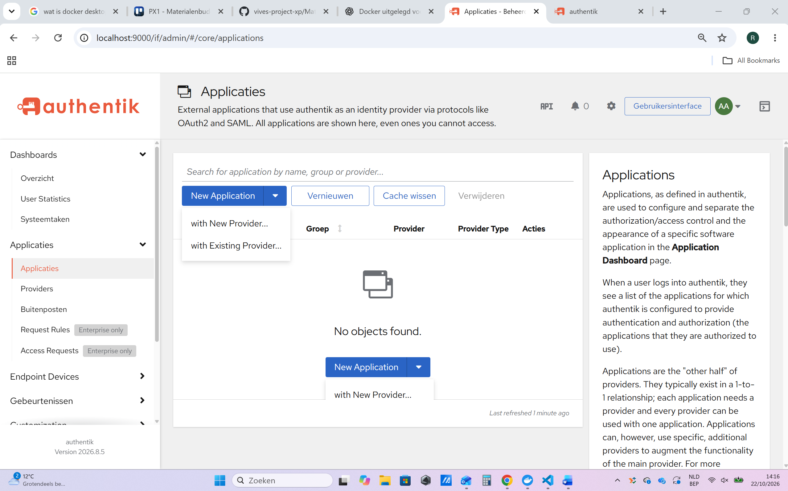

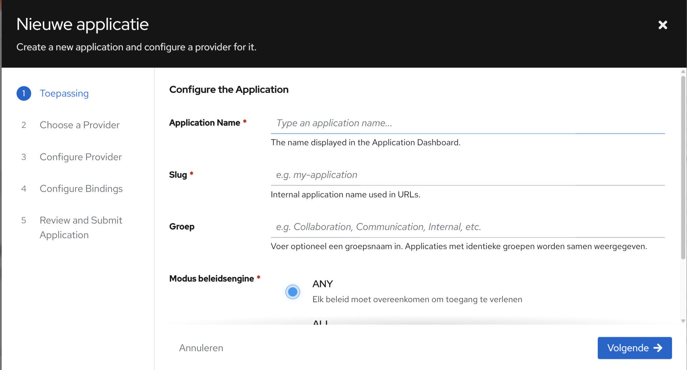

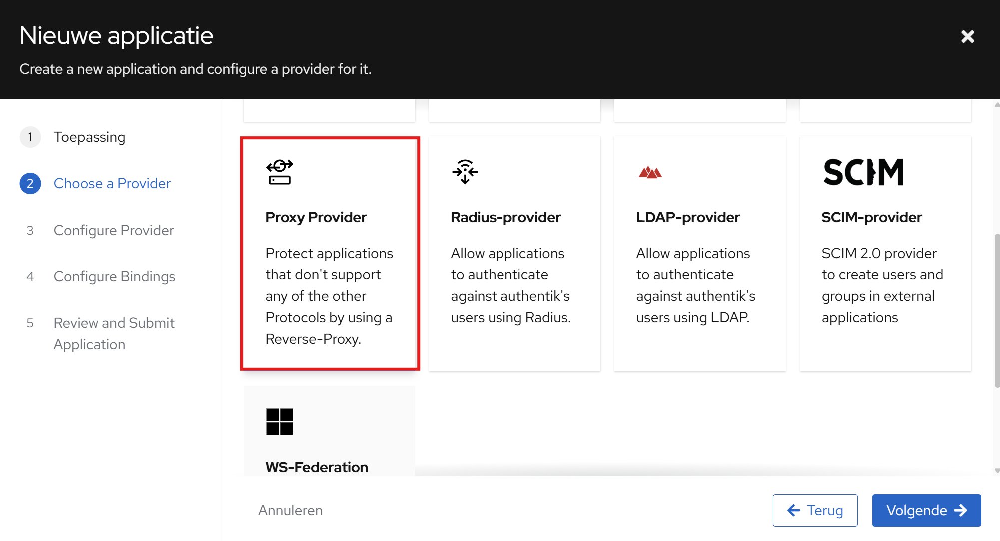

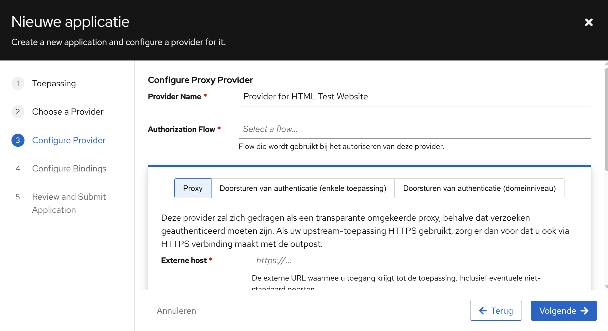

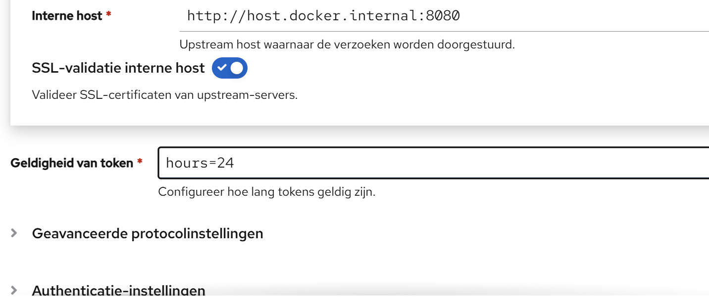

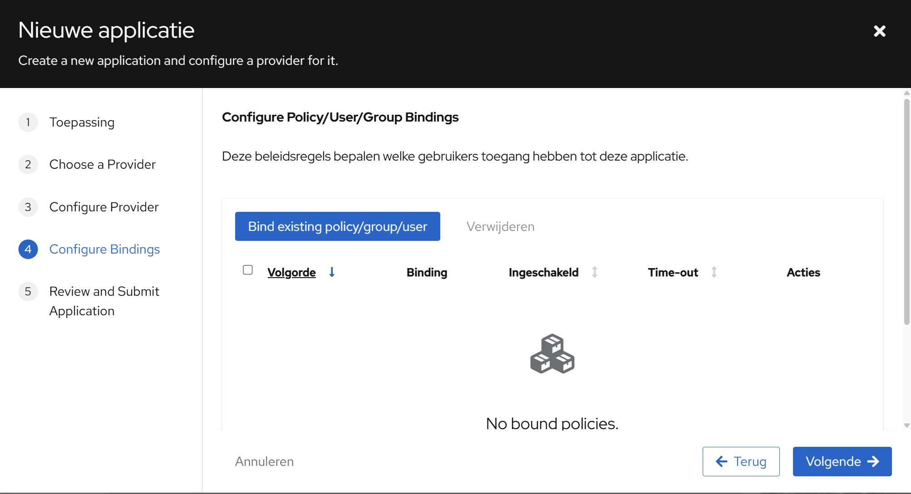

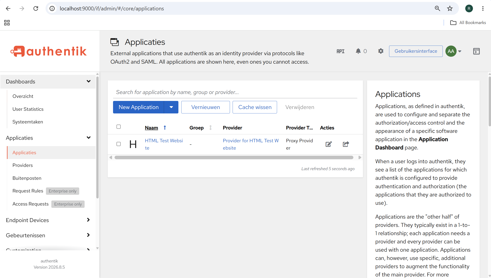


In de authentik-beheerinterface maakten we een nieuwe applicatie met een **Proxy Provider**.

| Instelling | Testwaarde |
|---|---|
| Applicatie | `HTML Test Website` |
| Slug | `html-test` |
| Provider | `Provider for HTML Test Website` |
| Type | Proxy |
| Externe host | `http://localhost:8081` |
| Interne host (eerste opzet) | `http://host.docker.internal:8080` |
| Authorization flow | `default-provider-authorization-implicit-consent` |

**Interne host** betekent waar authentik de echte website ophaalt. **Externe host** betekent het adres dat de bezoeker opent.

Bij de eerste applicatie lieten we de extra bindings leeg: ingelogde gebruikers konden toegang krijgen, zodra de proxy correct was aangesloten.

## 7. Embedded Outpost koppelen

**Screenshots uit het oorspronkelijke Word-document:**

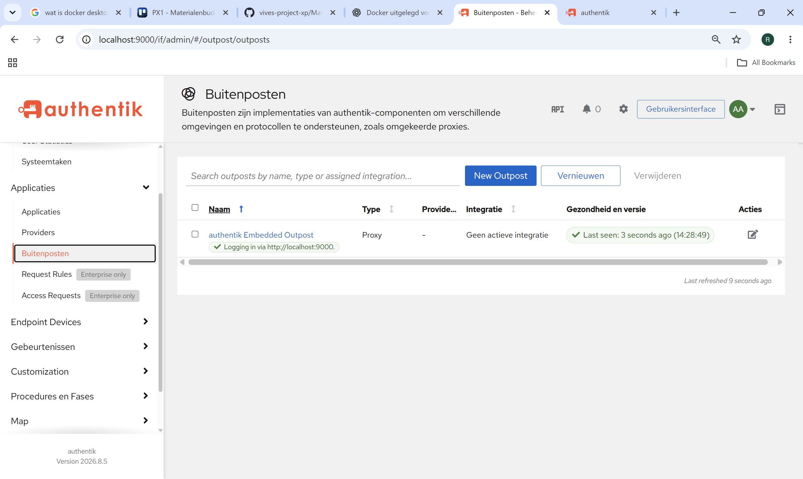

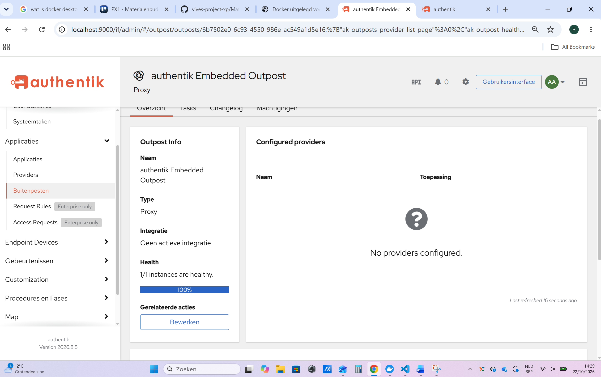

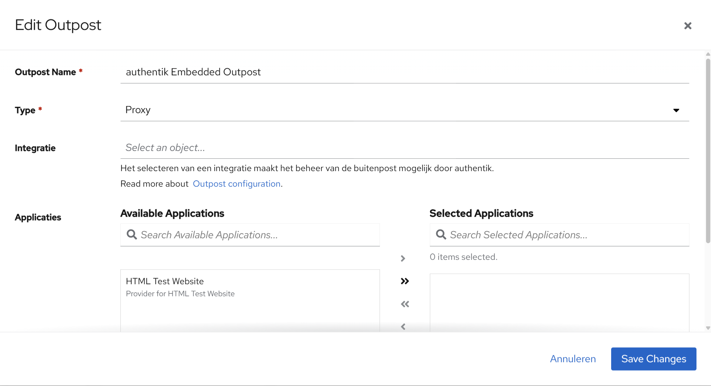

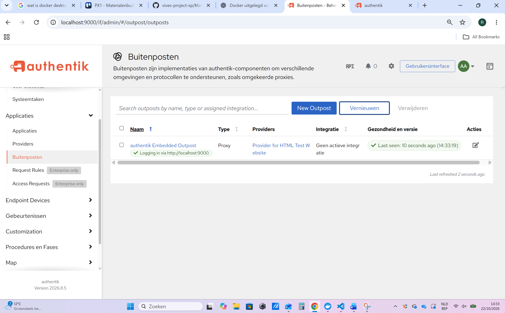


Via **Applicaties → Buitenposten → authentik Embedded Outpost → Bewerken** voegden we de applicatie `HTML Test Website` toe aan de geselecteerde applicaties.

We controleerden dat de outpost gezond was en de provider gekoppeld was.

In de authentik-serverconfiguratie voegden we ook de poortmapping toe:

```yaml
ports:
  - ${COMPOSE_PORT_HTTP:-9000}:9000
  - ${COMPOSE_PORT_HTTPS:-9443}:9443
  - "8081:9000"
```

Daarna werd de configuratie opnieuw toegepast met `docker compose up -d`.

**Belangrijk technisch onderscheid:** deze mapping maakt de authentik-server ook op poort 8081 bereikbaar. De mapping op zichzelf maakt **geen afzonderlijke beveiligde website**. Het resultaat hangt ook af van de Proxy Provider, externe host en routing.

We hebben vervolgens in een incognitovenster het inlogproces getest. De authentik-login verscheen en na aanmelden kon de testwebsite worden bereikt.

## 8. Gebruikers aanmaken en testen

**Screenshots uit het oorspronkelijke Word-document:**

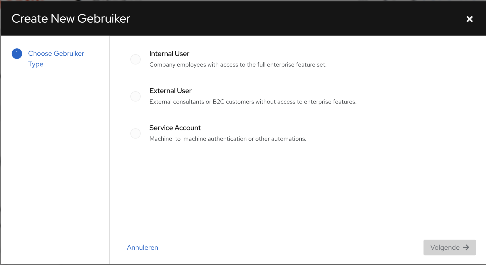

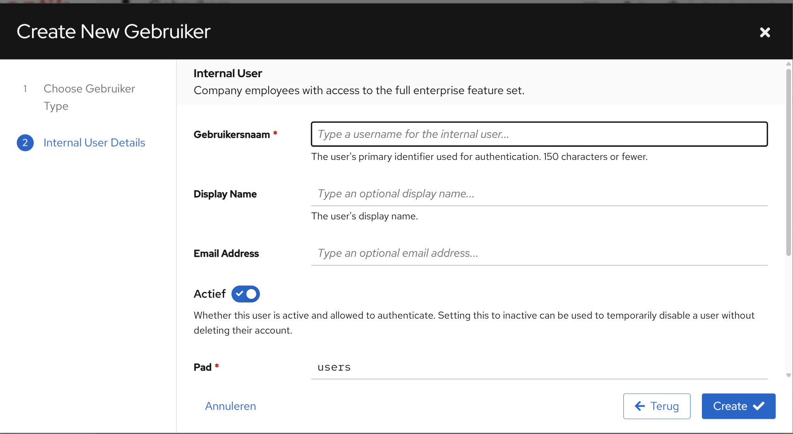

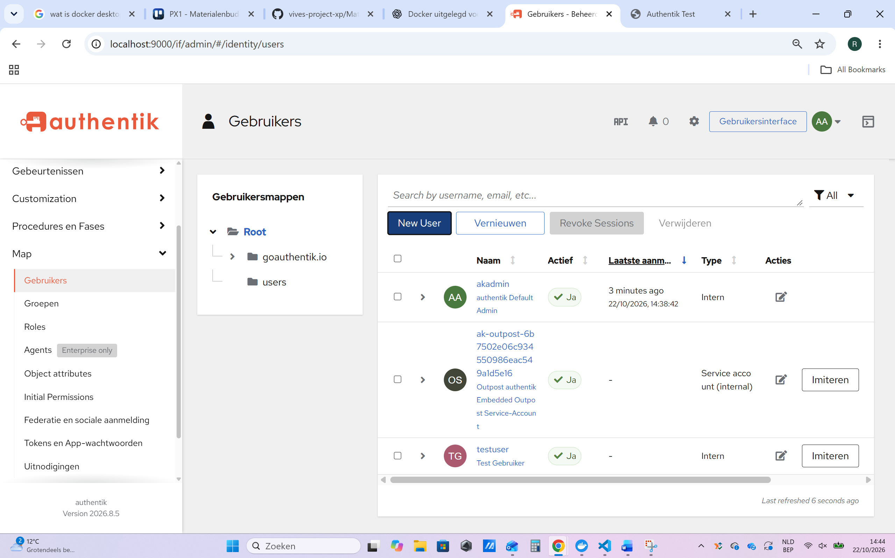


We gebruikten twee accounts:

| Account | Bedoeling |
|---|---|
| `akadmin` | Beheerder van de test |
| `testuser` | Gewone gebruiker |

De gewone gebruiker werd via **Map → Gebruikers** aangemaakt als *Internal User*. Daarna werd afzonderlijk een wachtwoord ingesteld. We hebben met beide accounts ingelogd en toegang getest.

**Opmerking:** het authentik-beheerdersaccount en een administrator van je **eigen website** zijn conceptueel verschillende rollen.

## 9. Groep voor websitebeheerders

**Screenshots uit het oorspronkelijke Word-document:**

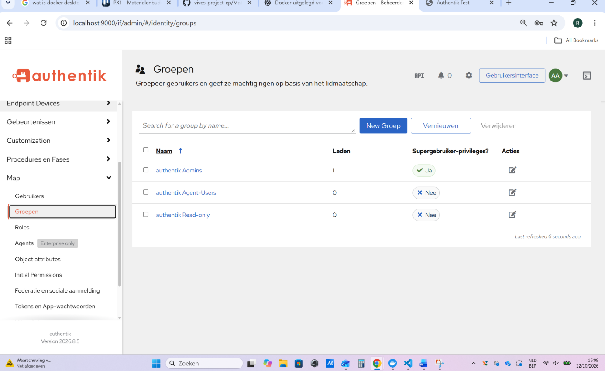


Via **Map → Groepen** maakten we de groep `website-admins` aan.

- `akadmin` werd aan `website-admins` toegevoegd.
- `testuser` werd **niet** toegevoegd.
- De optie **Superuser privileges** voor de groep bleef uit: lidmaatschap van een websitegroep mag niet automatisch volledige authentik-beheerrechten geven.

Dit was de basis om toegangsrechten per groep in te stellen.

## 10. Aparte adminpagina en adminapplicatie

**Screenshots uit het oorspronkelijke Word-document:**

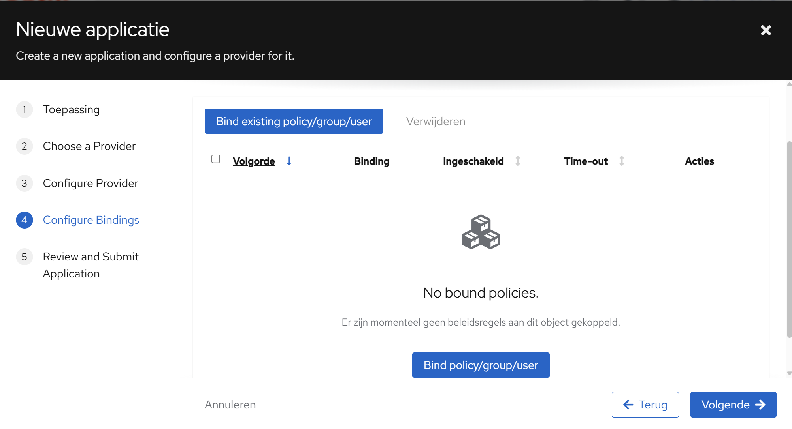

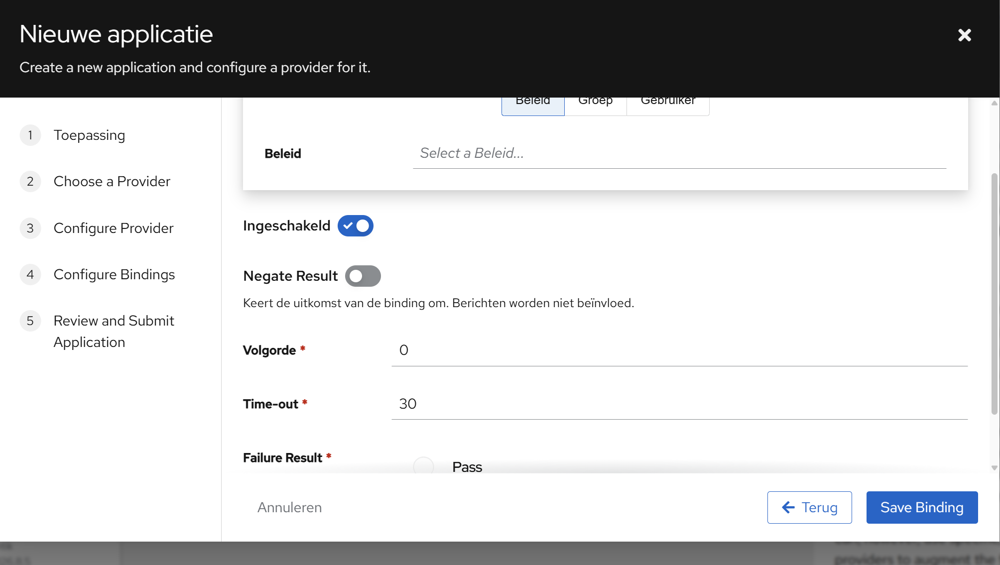


We maakten een eenvoudige `admin.html` met de tekst **Welkom, administrator!**. Vervolgens onderzochten we hoe we die pagina alleen voor admins bereikbaar konden maken.

We maakten in authentik een tweede applicatie:

| Instelling | Testwaarde |
|---|---|
| Applicatie | `Admin Website` |
| Slug | `admin-website` |
| Provider | `Provider for Admin Website` |
| Externe host | `http://localhost:8082` |
| Toegang | Groep `website-admins` |

Bij **Configure Bindings** selecteerden we een groepsbinding voor `website-admins`, met *Negate Result* uit en *Failure Result* op **Deny / Don't pass** (weigeren). Het doel is dat een gebruiker buiten de groep geen toegang krijgt.

Daarna koppelden we ook deze applicatie aan de Embedded Outpost en voegden we in de serverconfiguratie een mapping toe voor poort `8082`.

```yaml
ports:
  - ${COMPOSE_PORT_HTTP:-9000}:9000
  - ${COMPOSE_PORT_HTTPS:-9443}:9443
  - "8081:9000"
  - "8082:9000"
```

## 11. Docker-netwerken en twee Nginx-services

Later bleek dat de website en authentik in **verschillende Compose-projecten** draaiden. We controleerden de netwerken met:

```powershell
docker network ls
```

Daarbij zagen we onder meer `authentik-server_default` en `authentik-test_default`.

We hebben de netwerkverbinding aangepast zodat de proxy de juiste Nginx-service kon bereiken. Ook hebben we de website opgesplitst in twee Nginx-services:

- `website`: gewone website.
- `adminwebsite`: adminwebsite.

Een controle met `docker compose ps` liet beide services als **Up** zien. Hun interne webserverpoort was `80/tcp`; ze waren niet rechtstreeks op een hostpoort gepubliceerd in die controle.

**Niet volledig vastgelegd in het aangeleverde Word-document:** de exacte uiteindelijke `compose.yaml`-inhoud, netwerkdefinities en definitieve interne host van de adminprovider. Daarom nemen we hier geen onbevestigde eindconfiguratie op. Die kunnen we later rechtstreeks uit je actuele bestanden aanvullen.

## 12. Uitgevoerde tests en resultaten

Uit onze tests:

| Test | Resultaat |
|---|---|
| Eenvoudige HTML-pagina lokaal openen | Gelukt |
| Nginx via Docker starten | Gelukt |
| Authentik openen op poort 9000 | Gelukt |
| Authentik-inlogscherm voor de website tonen | Gelukt |
| Inloggen met beheerder | Gelukt |
| Gewone gebruiker aanmaken en inloggen | Gelukt |
| Admingroep gebruiken voor toegangscontrole | Getest |
| Adminwebsite met adminaccount openen | Gelukt |
| Adminwebsite met gewone gebruiker openen | Geweigerd |
| Afzonderlijke adminservice via Docker draaien | Gelukt |

Tijdens het instellen zagen we ook foutmeldingen en een **Not Found**-pagina. Daarna werden de Docker-services en verbindingen verder aangepast. Dat is een normaal onderdeel van het testen, maar de definitieve configuratie moet nog worden bewaard om alles reproduceerbaar te maken.

## 13. Belangrijke veiligheidsopmerking

Een HTML-knop verbergen is **geen beveiliging**. Een gebruiker kan immers zelf een URL invoeren.

Daarom hebben we de admintoegang met een **groepsgebonden authentik-beleid** getest. Toch moet je ook controleren dat de oorspronkelijke `admin.html` niet via de gewone website of een andere onbeveiligde route bereikbaar blijft. Ook eventuele API-endpoints moeten zelf de rechten controleren.

Deze test draait op `localhost` en gebruikt HTTP. Voor de echte schoolserver zijn onder andere HTTPS, veilige secrets, netwerktoegang en passende authenticatie-instellingen nodig.

## 14. Wat is nog niet gedaan?

We hebben **nog geen enkele gecombineerde website** gebouwd die na het aanmelden automatisch andere knoppen of functies toont op basis van de rol.

De volgende geplande stap is:

1. De twee aparte pagina's vervangen door **één website**.
2. Een kleine **Python/FastAPI-backend** toevoegen.
3. De identiteit en groepsinformatie van de aangemelde gebruiker betrouwbaar doorgeven aan die backend.
4. Voor admins extra bediening tonen.
5. De admin-API's ook **server-side** beveiligen, zodat URL's niet kunnen worden omzeild.

Dat is een toekomstige uitbreiding, geen onderdeel dat al werkt.

## 15. Wat bewaren om dit later opnieuw op te bouwen?

Bewaar minstens:

- `authentik-test/index.html` en eventuele `admin.html`.
- De **actuele** `authentik-test/compose.yaml`.
- De **actuele** `authentik-server/compose.yml`.
- Een voorbeeldbestand `.env.example` **zonder echte wachtwoorden of sleutels**.
- De ingestelde authentik-applicaties, providers, groepsbindingen en outpostkoppelingen (eventueel met screenshots of een veilige export).
- Een overzicht van de Docker-netwerken en gebruikte poorten.

**Let op:** authentik-instellingen zitten grotendeels in de PostgreSQL-database. Alleen de Compose-bestanden bewaren is dus niet voldoende om alle aangemaakte gebruikers, groepen en providers automatisch terug te krijgen.

---

*Samenvatting: we hebben Docker, Nginx en authentik lokaal werkend gekregen, gebruikers en groepen aangemaakt en aparte toegang voor een adminwebsite getest. De overstap naar één website met rollen en FastAPI is onze volgende fase.*
